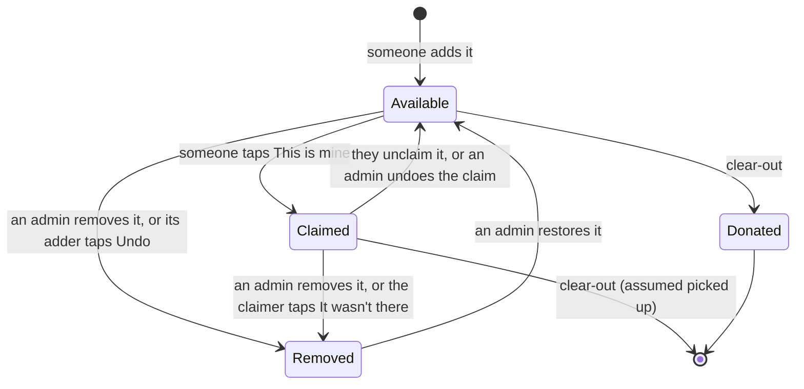

# PTA Lost and Found — Product Spec

Nov 20, 2026 · @Russ · Draft v0.3

## Overview

A small web app that puts the school's lost and found online. Anyone at the school can photograph an item that lands in the bin: a volunteer adds the whole bin in one sitting, and a parent who handed something in can add it from a photo already on their phone. Families scroll a grid of photos on their phone, tap *This is mine* on anything that belongs to them, and take it from the bin. A claimed item leaves the grid and goes into the family's *My items* list.

**Problem today:** families only see what is in the bin if they happen to walk past it, so most things sit there until they are donated at the end of the term.

**What the app does:** lets families look through the bin from home, and turns clear-out day into one tap.

It belongs with the PTA's other tools ([reimburse-me](https://github.com/MiralomaPTA/reimburse-me) and asset-manager) and is built on the same base, Next.js on Vercel's free tier. It stores its data differently: the item details in a few JSON files and the photos in a Cloudflare R2 bucket, instead of a Google Sheet and Drive. It sends no email.

## Goals and non-goals

**Goals**

- Anyone can look through everything in the lost and found from a phone with no account or sign-in, and claim an item in one tap right from the grid.
- Anyone can add an item, and it shows on the grid right away.
- Every mistake takes one tap to undo, by whoever made it or by an admin. Two exceptions: once the person who added an item leaves the add screen, only an admin can remove it; and the clear-out asks for confirmation, and admins run it only after the bin has been emptied.
- With bulk add, anyone can photograph and tag most items in two taps and about 5 seconds, so a volunteer can do a full bin in one sitting. Adding one item from a photo already on the phone takes a few taps and a crop.
- Clear-out is one tap, and afterward nothing from before it keeps a photo.
- Zero added running cost, as with the other apps: Vercel Hobby, GitHub Actions, Cloudflare R2's free tier and the lostandfound@ account on the PTA's existing Google Workspace for Nonprofits. AI tagging, which would add a small cost, is a later phase.
- Sized for about 75 new items a week, 300 on the list at peak, and every family at the school.

**Non-goals (for now)**

- AI tagging. People tag by hand for now, and the data is laid out so AI can fill in the same fields later (see *Phase 2*).
- Checking that a claim is genuine. Claims are on the honor system; admins undo mistaken claims.
- Approving items before they appear. New items post right away; admins remove anything that shouldn't be there.
- Limits and blocking. The school is a high-trust setting: there is no daily cap on claims or adds, and no way to block a phone. The school code is the only fence.
- Handing items back. Families take claimed items from the bin themselves, and the app doesn't track pickup.
- Numbered tags on items, or more than one bin.
- Checking the bin against the app. A family who goes looking and doesn't find an item reports it (*It wasn't there*); otherwise the monthly clear-out resets the list.
- Any tag beyond type, color and *Has a name*: no notes, sizes, brands or dates for anyone to fill in.
- Recording names. People adding items mark only whether an item has a name written on it, not what the name is. Families don't list their kids' names, and nothing is matched by name.
- Accounts. Nobody signs in or gives an email address, admins included: admins use an admin code. *My items* lives on the phone they claimed with. Seeing claims across phones isn't worth an account.
- Email from the app. It sends none: no sign-in links, no weekly digest, no clear-out reminders. People can still write to lostandfound@miralomasf.com with questions (section 8).
- Families reporting something they lost ("blue rain jacket, size 8") and hearing when one turns up.
- Valuables (phones, keys, wallets, glasses, medication). These stay with the office and aren't posted (open question 2).
- Languages other than English.

## Users and roles

There are two roles. There is no helper role: anyone with the school code can add items, and admins do everything else that needs a person in charge.

| Role | Who | What they can do |
| --- | --- | --- |
| Everyone | Anyone with the school code. No account and no sign-in | Browse the grid; claim and unclaim items; mark a claimed item *It wasn't there*; add items, in bulk or one from a photo; undo their own add until they leave the add screen; fix the tags on any item; see *My items* |
| Admin | Anyone who has entered the admin code on their phone. The code is shared only with admins (open question 5) | Everything anyone can do. See who added and claimed what; replace an item's photo; remove and restore items; undo claims; restore items reported missing; run the clear-out and move or skip a clear-out date; change the school code, the admin code, the bin description, and the types and colors lists |

**Everyone: a school code, no sign-in.**

- The first visit asks for the school code: a short word printed in the newsletter and on a sign at the bin (open question 9). After that the phone is remembered and opens straight to the grid. Admins can type the admin code in the same box (below).
- The phone is remembered by a random ID in a cookie that lasts a year from the phone's last visit (open question 1). Nothing else is stored about the person until they claim or add something.
- The first claim or the first add asks for a name for admins to see next to it, such as "Lee family, Rm 12". The phone remembers it, and it can be changed in *My items*.
- *My items* belongs to the phone. A different phone, or clearing the browser, starts a new list, and earlier claims still stand.
- When an admin changes the school code, for example at the start of the school year or if it spreads beyond the school, every phone is asked for the new one. Each phone keeps its ID, name and *My items*.
- Wrong codes are slowed down: after 5 in a row, that browser waits a minute.

**Admins: an admin code.** Admins don't sign in or get email. They type a second code that is shared only with admins.

- Typing the admin code in the first-visit code box makes that phone an admin. It also counts as entering the current school code. A phone that's already in uses *Admin code* in the footer.
- If the phone has no name yet, it asks for one, so the admin pages and the activity log can say who did what ("Done by Dana").
- A phone stays an admin until an admin changes the admin code, or until its cookie expires or the browser is cleared. *Leave admin* on Settings turns that phone back into an ordinary one.
- There is no list of admins and no way to remove a single phone. To take access away, an admin changes the admin code and gives the new one to the admins who should keep it. Every other admin phone becomes an ordinary phone within a few seconds, keeping its name and *My items*.
- Wrong admin codes count toward the same slowdown as wrong school codes. Because a script can ignore that browser cookie, each server also counts wrong codes per network address (20 in 15 minutes), and the admin code has to be hard to guess: at least three words of three or more letters, 15 characters in all, such as three random words (open question 14).
- Settings shows the admin code to admins, so an admin can pass it on to a new one.

There are no user lists. Each phone has its own small file, which also records whether it holds the current admin code (see *Storage layout*).

## How it works

1. **Find.** Someone photographs an item from the bin and taps its color, which saves it. Volunteers use *Bulk add* to do the whole bin in one sitting; a parent who handed something in can use *Add one from a photo*. It appears at the top of the grid right away.
2. **Claim.** A family taps *This is mine* on the item's card in the grid. The item leaves the grid for everyone and goes into that family's *My items*. A mistake takes one tap to undo.
3. **Pick up.** The family takes it from the bin. The app doesn't record this.
4. **Clear out.** On the second Friday of each month, volunteers donate whatever is in the bin and an admin taps *Clear out* on the admin page. Every item still on the list becomes *Donated*. Claimed items are assumed picked up, so they stay *Claimed* and are not counted as donated. All the photos are deleted.

Each item has one status:

*Removed* covers anything that left the bin outside the app: returned to a student in person, thrown away, a duplicate photo, an add its adder undid, or an item a family went to pick up and didn't find. An admin can restore a removed item until the next clear-out.

## Functional requirements

### 1. The grid

- Square photo cards: two columns on a phone, more on a wider screen. Each card shows the photo, the type and color, the item's age, and a *This is mine* button (section 2).
- **Age** is worked out from the date the item was added, counted in days in Pacific time, and nobody types it in: "Today", "1 day", "6 days", then whole weeks ("1 week", "3 weeks"). It isn't stored; the page works it out from `added_at` each time it loads.
- **Sort:** *Newest first* (the default) or *Oldest first*.
- Filter by type and by color (a chip for each), by *Has a name*, and by *New this week*. *Has a name* shows only items with a name written on them, so a family that labels its things can check just those. There is no search box, because the filters cover every tag.
- The header shows the next clear-out date. In the last 7 days before it, a banner says: "Everything still here on Fri, Dec 11 goes to donation." A family with open claims also sees "Pick up your 2 claimed items before then", because the whole bin is emptied on that day.
- If a date passes without a clear-out, families aren't told they have until next month: the header says "Any day now" and the banner says "The Fri, Dec 11 clear-out hasn't happened yet. Everything still here goes to donation when it does", until an admin runs it.
- **Item page:** the large photo with pinch-zoom, type, color, its age and the date it was added, *This is mine*, and *Fix tags* (section 5). Swipe or arrows move to the next item in the current filter and sort. An item that has been claimed says "This item has been claimed. If it's yours, email the PTA"; one that was cleared out says "This item was donated on Dec 11." Either can be reached from an old link.
- Thumbnails load as they scroll into view. About 300 items fits on one page.
- The bottom bar has three tabs: *All items*, *Add* (section 4) and *My items* (section 3).
- The footer of every page links to lostandfound@miralomasf.com for questions and concerns (section 8), and to *Admin code*.

### 2. Claiming

- **From the grid.** Every card has a *This is mine* button under the photo, so a family can claim without opening the item. Tapping the photo itself opens the item page, which has the same button.
- **No confirmation step.** The claim takes effect at once, because undoing it is just as quick:
  - The card stays where it is, dimmed, showing "In My items" and an *Undo* button, so the grid doesn't shift under the family's thumb. It leaves the grid the next time the page loads.
  - A bar at the bottom says where to go: "Pick it up from the lost-and-found bin by the main office." An admin sets the bin's description (open question 7).
  - *Undo* puts the item straight back on the list.
- The first claim or add from a phone also asks for the name admins will see (see *Everyone* above). Later claims and adds don't ask again.
- A family can also unclaim from *My items* at any time before the clear-out. The item goes back on the grid in its old place, by date added.
- If someone else claimed it a moment earlier, the card says "Someone just claimed this. If it's yours, email the PTA," linking to lostandfound@miralomasf.com. The app saves a claim only if the item list hasn't changed since it was read (see *Safe writes*).
- There is no daily limit on claims.
- Only admins see who claimed an item.

### 3. My items

- The name admins see is at the top, with *Change*.
- A list of the claims made from this phone, newest first. Each shows the thumbnail, type and color, the claim date and one of:
  - **Claimed**, with *Unclaim* and *It wasn't there* buttons.
  - **Not in the bin**, after the family tapped *It wasn't there*.
  - **Put back by an admin**, with the admin's note if there is one ("This belongs to another student.") and a link to email the PTA with questions.
  - **Picked up**, for a claim from before the last clear-out, which the app assumes the family collected. *Unclaim* and *It wasn't there* are gone by then. It is shown without a photo, since the clear-out removes it.
- Claims the family unclaimed themselves drop off the list.
- **It wasn't there.** Items sometimes leave the bin without anyone claiming them in the app: a child spots their jacket and takes it. A family who claimed an item and couldn't find it taps *It wasn't there*, with an *Undo* bar afterward. The claim closes, and the item becomes *Removed* with the reason "not in the bin", so it stays off the grid for everyone. Admins see it under *Reported missing* (section 6) and can restore it if it turns up. Otherwise the monthly clear-out resets the list.

### 4. Adding items (anyone)

Anyone with the school code can add an item, and it shows on the grid right away, with no approval step. The item should already be in the bin; both add screens say "Only add things that are in the lost-and-found bin."

*Add* in the bottom bar offers two ways in:

- **Bulk add**, for someone at the bin with a pile of things to photograph one after another.
- **Add one from a photo**, for an item someone has already photographed and handed in.

Each item gets three tags and nothing else: type, color, and whether it has a name.

- **Type:** one chip from the types list, with a short label ("Jacket", "Water bottle").
- **Color:** one swatch from the colors list, including Multicolor.
- **Has a name:** a toggle, on when a name is written anywhere on the item. The name itself is never typed in.

**Bulk add.** Tagging has to be fast enough that a full bin takes one sitting. Most items take two taps.

- **One screen.** A live camera view at the top of the page, with the tags underneath. Everything fits on a phone screen without scrolling (open question 12).
  - The type stays selected from the last item, so a run of water bottles needs no type taps.
  - *Has a name* resets to off for each item.
- **Two taps per item.**
  1. The person taps the shutter, and the photo freezes, already cropped to the item (below).
  2. Tapping a color saves the item and brings back the live camera for the next one.

  Changing the type or turning on *Has a name* is one more tap each, done before the color. Tapping the frozen photo retakes it.
- **Cropped to the item, automatically.**
  - The live camera shows a square frame, and the photo is cut to that square.
  - Volunteers work at a photo spot with a plain backdrop, such as a solid-color poster board (open question 11). The browser trims the backdrop from around the item, leaving a small margin, so the frozen photo already shows the crop.
  - If the trim can't find a clear edge (a busy background, or an item the same color as the backdrop), the square is kept. A *Full photo* button under the frozen photo undoes a bad crop.
  - A trimmed photo isn't always square, so cards show the whole photo centered on a plain background.
- **Fixing a mistake.** A strip along the top shows the items saved since bulk add was opened. Tapping one opens it to change its tags, or *Undo* to take it off the list. Once the person leaves bulk add, anyone can still fix its tags from the item page, but only an admin can remove it.
- **Saving doesn't wait.** Each item uploads in the background while the person carries on, and the strip shows each upload's progress. A failed upload stays in the strip with *Retry*, and the page warns before it is closed with uploads still waiting.
- **Without the live camera** (permission refused, or an older browser), bulk add falls back to the phone's own camera app, with the same tags after each photo.

**Add one from a photo.**

- It opens the phone's photo picker for one photo.
- **Crop by hand.** The photo appears with a square crop box. The browser runs the same backdrop trim first to place the box; since most of these photos aren't on the backdrop, the box usually starts as the largest square around the middle. The person drags the box to move it and pinches, or drags a corner, to resize it. *Reset* puts it back where it started. The help line suggests cropping out any written name.
- The same three tags sit underneath. Nothing is pre-selected; *Add to the grid* is enabled once a type and a color are picked.
- After saving, a bar says "Added to the grid" with *Undo*, which lasts until the person leaves the screen, and *Add another* picks the next photo.

**For both:**

- **Photos:** the browser converts HEIC from the camera roll, resizes every photo to at most 1600 px (which keeps uploads under Vercel's 4.5 MB request limit), and makes the 400 px thumbnail too. Both are uploaded and stored in the bucket. Unlike asset-manager, the server uses no image library such as sharp, so nothing ties it to Vercel (see *Hosting*).
- The date added and the phone that added it are recorded automatically, and the item's age comes from the date. Item IDs are sequential, e.g. L-0142. Admins see them; nobody else does.
- The first add from a phone asks for the name admins will see, as the first claim does.
- Once the person has left the add screen, they can ask for an item to be removed by emailing lostandfound@miralomasf.com. The add screens say so.

### 5. Fixing tags (anyone)

- The item page has *Fix tags*, which opens the same type, color and *Has a name* controls as the add screens. Anyone can change them, and the change shows to everyone right away, with an *Undo* bar for a few seconds.
- The photo can't be changed here. Only an admin can replace a photo (section 6).
- Every change goes in the activity log with the phone that made it, so an admin can see who changed what and put it right.

### 6. Managing items and claims (admins)

The admin section has four tabs: *Items*, *Claims*, *Clear out* (section 7) and *Settings*.

- **Items** shows the same grid, with the same ages and sort, every status, a status filter (available, claimed, removed), and each item's ID and who added it. Tapping a card opens its tags, plus *Replace photo* and *Remove*.
- **Remove** asks for a reason: returned in person, gone from the bin, duplicate or mistake, thrown away, or other. A removed item can be restored until the next clear-out.
- **Reported missing**, at the top of *Claims*, lists the items families marked *It wasn't there*, newest first, with the name the family gave and a short code for the phone. If an item is actually in the bin, *Restore* puts it back on the grid.
- **Claims** lists recent claims, newest first. Each shows the item's thumbnail, the name the family gave, a short code for the phone (so two "Lee family" claims can be told apart), and when. *Undo claim* takes an optional note the family sees in *My items*, and the item goes back on the grid.
- **Undo.** Removing an item, replacing a photo and undoing a claim each show an *Undo* bar for a few seconds afterward. After that, a removed item can still be restored until the next clear-out.
- The activity log records every add, undone add, tag change, photo replacement, claim, unclaim, undo, removal, restore and clear-out.

### 7. Clear-outs (admins)

- **Due monthly, on the second Friday.** The app works out the dates itself, and the next one shows in the header. Nothing happens automatically on the date: a clear-out runs only when an admin taps *Clear out* on the admin section's *Clear out* tab.
- **The Clear out tab** has the *Clear out* button and the next date, the coming dates with *Move* and *Skip* (for example when school is closed that Friday, or over the summer), and the past clear-outs with their counts and a CSV for each.
- On the day, volunteers bag up what is in the bin and donate it, then an admin taps *Clear out*. The confirmation gives the numbers: "This marks the 214 items still on the list as donated, closes 37 claims as picked up, and removes all their photos."
- A clear-out:
  - Marks every available item *Donated*.
  - Leaves claimed items *Claimed*: the app assumes the family picked them up, so they never count as donated. Their open claims close as *Picked up*.
  - Deletes from the bucket the photos and thumbnails of every item that is no longer available, removed items included. Nothing from before the clear-out keeps a photo.
  - Writes an archive file for that clear-out, with every item it closed and the counts.

  The list then starts empty, with a fresh `items.json`. Item numbers carry on from where they were.
- There is no undo. The confirmation is the safeguard: it says "Only do this after the bin has been emptied", and a clear-out is never started by the app.
- It is a button rather than a scheduled job so the app matches what happened at the bin, even when the date slips. If a clear-out date passes without a clear-out, admins see "The Dec 11 clear-out hasn't been done yet."

### 8. Email and questions

- The app sends no email. Admins use the admin code instead of sign-in links, and families get no reminders or digests.
- **lostandfound@miralomasf.com** is the address for questions and concerns, instead of asking at the school office. The app links to it (`mailto:`) in the footer of every page, on the help page, in the claim-conflict message, on a claimed item's page, next to an admin's note in *My items*, and on the add screens for getting an item removed.
- The admins read that inbox (open question 15). Someone who writes to it shares their email address only with whoever reads it; the app itself still stores none.

## Phase 2: AI tagging (later)

Not part of the MVP. It is described here so the MVP's data fits it.

- When someone adds a photo, the app sends it to Claude. Claude pre-selects the type, the color and the *Has a name* toggle, which the person can change. It also fills in fields too slow to enter by hand:
  - A more specific type: puffer jacket, hoodie, rain boots.
  - Brand.
  - Style: girl, boy or either.
  - A one-line description.
- The new fields get their own filters, and a search box comes back to search them.
- A one-time backfill tags the items already on the list through the Message Batches API, at half price.
- **How:** one Messages API call per photo, sending a version of about 1000 px with a JSON schema for the answer (structured outputs). The new fields are added to each item's record in `items.json`.
- **Cost** at about 75 photos a week, or 2,700 a school year (estimates):

  | Model | Per photo | Per school year |
  | --- | --- | --- |
  | Claude Opus 5.5 | About 1.5¢ | About $40–50 |
  | Claude Haiku 5.5 | About 0.05¢ | About $1–2 |

  Opus 5.5 is more reliable on small logos and small details.
- **To decide before starting:** this would be the app's first running cost, and the first time photos go anywhere but the PTA's own bucket, since they go to Anthropic's API.

## Technical architecture

The same web app setup as asset-manager, but the data lives in a storage bucket instead of a Google Sheet and Drive folder:

- **Web app:** Next.js on Vercel's free (Hobby) tier. TypeScript, Tailwind and zod; vitest for unit tests. GitHub Actions CI runs typecheck, lint and tests on every push.
- **Hosting:** Vercel for the app and R2 for storage, rather than everything on Cloudflare. Running Next.js on Cloudflare Workers would probably need the $5-a-month paid plan to fit its size and CPU limits (check the current limits before revisiting this). A custom domain there would also mean moving miralomasf.com's DNS, Google Workspace mail records included, to Cloudflare, and it would be the one PTA app deployed differently. The server code avoids Vercel-only features and native modules, so a later move stays cheap.
- **Storage:** one Cloudflare R2 bucket holds everything: a few small JSON files with the item details, and the photos. The app uses R2's S3 interface (the AWS SDK's S3 client pointed at R2), so it could move to Amazon S3 later without code changes. R2 rather than S3 because R2's free tier doesn't expire and downloads are free.
- **Adapters:** `STORAGE=local` keeps the same files under `./.data` for development. `STORAGE=r2` uses the bucket. A production build refuses to run with local storage.
- **No email and no scheduled job:** admins use a code instead of emailed links, so unlike asset-manager and reimburse-me there is no Gmail API or service account. The clear-out is a button, so nothing runs on a timer.
- **Phones:** a random ID in an HttpOnly cookie, plus a second cookie recording which school code was entered. Both are set by the server rather than by page scripts, because some browsers expire script-set cookies after a week, and each page visit renews them for another year. In production their names start with `__Host-`, so a page on another miralomasf.com subdomain can't plant one. A phone's own file is rewritten at most once a day to update `last_seen_at`. A phone is an admin while its file's `admin_code_at` matches `admin_code_changed_at` in `settings.json`. The cookie carries only the phone's random ID, so editing it can't make a phone an admin.
- **Live camera:** bulk add uses the browser's camera API (`getUserMedia`) with the rear camera, and grabs a still frame from the video. It needs HTTPS, which Vercel provides. The phone's own camera app, through a file input, is the fallback.
- **Auto-crop:** runs in the browser on a canvas before upload. It samples the color along the photo's edges, moves each edge inward until it reaches pixels that differ from that color, and adds a margin. It uses no model and costs nothing, and only the cropped photo is uploaded.
- **Manual crop:** *Add one from a photo* draws the photo on a canvas with a square crop box over it. Pointer events move the box, and a pinch or a corner handle resizes it, kept inside the photo. Only the cropped photo is uploaded.

### Storage layout

The bucket, "miraloma-pta-lost-and-found":

| Object | Holds | Written when |
| --- | --- | --- |
| `items.json` | Every item since the last clear-out, with its claims, plus the next item number and which clear-out the list started after. About 100 KB at peak | Any add, tag change, photo replacement, claim, unclaim, undo, removal or restore, with a safe write (below) |
| `devices/<id>.json` | One phone | The phone changes its name or enters the admin code, or once a day for `last_seen_at` |
| `settings.json` | The school code, the admin code and other settings, the types and colors lists, and clear-out dates an admin moved or skipped | An admin changes something |
| `activity/<date>/<time>-<id>.json` | One action | Every action, as a new file that is never rewritten |
| `archive/<clear-out date>.json` | Every item that clear-out closed, without photos, and the counts | Once, by that clear-out |
| `backups/items-<date>.json` | A copy of `items.json` as it was before that day's first write | The first write of each day |
| `photos/<random>.jpg`, `photos/<random>-thumb.jpg` | Each item's photo and thumbnail | An upload; deleted by the clear-out, or when an admin replaces the photo |

| Record | Fields |
| --- | --- |
| Item, in `items.json` | id (e.g. L-0142), status (available / claimed / removed / donated), type, color, has_name, photo and thumbnail names, added_by (a phone's ID), added_by_name (as given at the time), added_at, updated_at, updated_by, removed_at, removed_by, removed_reason, donated_at, claims |
| Claim, inside its item | id, device_id, name (as given at the time), claimed_at, status (open / unclaimed / undone / not found / picked up), ended_at, ended_by, note |
| Phone, `devices/<id>.json` | id (random), name, created_at, last_seen_at, admin_code_at (the version of the admin code it entered, if any) |
| `settings.json` | school_code, code_changed_at, admin_code, admin_code_changed_at, bin_description; types (name, sort, active); colors (name, swatch hex color, sort, active); clear-out changes (date, moved or skipped, moved_to, note) |
| Activity entry | at, actor (a phone's ID), as_admin, action, item_id, claim_id, detail |
| `archive/<date>.json` | done_at, done_by, donated_count, picked_up_count, and the closed items with their claims |

- **Starting lists** (open question 6), written to `settings.json` on first use:
  - Types: Jacket, Shirt, Hoodie, Sweatshirt, Hat/Gloves, Shoes, Water bottle, Lunch box, Backpack, Toy & sports, Other.
  - Colors: Black, White, Gray, Navy, Blue, Light blue, Green, Red, Pink, Purple, Orange, Yellow, Brown, Tan, Multicolor.
- **Safe writes.** R2 has no transactions, but it can refuse a write when the file has changed since it was read. Checked in Phase 0 on Nov 20, 2026: R2's S3 interface refuses out-of-date writes and lets exactly one of several racing writes through, so the app writes to R2 directly (see *Rollout plan*):
  - Every change to `items.json` reads the file and its version tag (ETag), makes the change, and writes the file back only if the tag still matches.
  - R2 checks this as part of the write, so when two writes race, one succeeds and the other is refused. The app then re-reads and tries again, a few times at most.
  - A claim on an item someone else claimed in between fails cleanly: "Someone just claimed this." Two people fixing the same item's tags at once both succeed, one after the other, and the later change wins.
  - Writes to `items.json` come a few a minute at the busiest, even with two volunteers doing bulk adds at once, so retries are rare. `settings.json` uses the same safe write. A phone's own file and new activity files don't compete with anything, so they are written directly.
- **Reads.** A page reads `items.json`, `settings.json` and that phone's file, which also says whether the phone is an admin.
  - A short in-memory cache (a few seconds, cleared on that server's own writes) smooths out bursts after a newsletter link.
  - Filtering and sorting happen on the server. At about 300 items there is nothing to query.
  - R2's free tier includes 10 million reads a month, with no per-minute limit like Sheets'.
- **My items** reads the phone's claims from `items.json` and from the last clear-out's archive, which is where *Picked up* claims come from. An old link to a cleared-out item is answered from the archives.
- **Photos** are stored under random, unguessable names. The app serves them at `/photos/<name>` with headers that let Vercel's CDN and browsers keep each one for a day, so the bucket is read about once a day per photo, and a photo an admin removes or a clear-out deletes stops loading within a day. A replaced photo gets a new name, so the CDN never serves the old one for the item. If miralomasf.com's DNS ever moves to Cloudflare, the bucket's own public address could serve them instead.
- **Backups and repairs.** Each day's first write leaves a dated copy of `items.json`, and every clear-out leaves its archive. To undo a bad write, an admin copies a backup over `items.json` in the Cloudflare dashboard.
- **No hand editing.** JSON in a bucket isn't meant to be edited by hand. The admin section covers everything an admin needs to change: the school code, the admin code, the bin description, types and colors, and clear-out dates. It also offers *Download CSV* of the current list and of each clear-out's counts.
- **Ownership:** code in the MiralomaPTA GitHub organization; the Vercel project and the Cloudflare account under lostandfound@miralomasf.com.

### Screens

| Path | What |
| --- | --- |
| `/` | The school code on a phone's first visit, then the grid |
| `/items/[id]` | Item page: large photo, *This is mine* and *Fix tags* |
| `/mine` | My items, and the name admins see |
| `/add` | Choose *Bulk add* or *Add one from a photo* |
| `/add/bulk` | Bulk add from the live camera |
| `/add/photo` | Add one item from a photo, with a crop box |
| `/admin/items`, `/admin/items/[id]` | Admin: every item by status; fix tags, replace the photo, remove, restore |
| `/admin/claims` | Admin: reported missing and recent claims; restore, undo |
| `/admin/clear-out` | Admin: *Clear out*, coming dates (move, skip), past clear-outs and their CSVs |
| `/admin/settings` | Admin: the school code, the admin code, the bin description, types and colors, CSV of the current list, and *Leave admin* |
| `/photos/[name]` | A photo or thumbnail, cached by Vercel's CDN |
| `/admin-code` | Enter the admin code, for a phone that's already in |
| `/help` | How it works, for everyone and for admins, and the address for questions |

## Data, privacy and retention

- **What we store:** the name each phone gives when claiming, adding or becoming an admin, a random ID for each phone, which phones hold the admin code, item photos, and who added, retagged and claimed what. The app stores no email addresses; someone who writes to lostandfound@ shares theirs only with whoever reads that inbox.
- **Who sees what:**
  - Anyone with the school code sees the photos of items on the list, with their type and color. The code keeps out strangers and search engines, but every family has it and it's printed at the bin, so it is a light fence, not a lock. Photo addresses are random and can't be guessed, but anyone who is given one can open it.
  - Who added, retagged and claimed what: admins.
- **Known limits:**
  - A photo can show a child's name written on a label, and anyone with the code can see it. The add screens ask people to turn labels away from the camera or crop them out.
  - Anyone with the code can post a photo, and it shows right away. Admins remove anything that shouldn't be there, and the activity log shows which phone added it.
- **Where:** the R2 bucket, in a Cloudflare account owned by lostandfound@miralomasf.com. Admins see the data through the admin section and its CSV downloads.
- **Retention:** each clear-out deletes the photos of everything that has left the list. The clear-out's archive keeps the rest of each item (type, color, dates) for counts. A clear-out also deletes the files of phones not seen in a year. A phone stays an admin until the admin code changes.

## Rollout plan

1. **Phase 0: Setup.**
   - Create lostandfound@miralomasf.com, to own the Cloudflare and Vercel accounts and to receive questions and concerns. Forward its mail to the admins, or give them access to the inbox (open question 15).
   - As lostandfound@, create a Cloudflare account, an R2 bucket, and an API token that can reach only that bucket. The app creates its files on first use.
   - Check safe writes before building on them. A short script writes an object, changes it, then tries a write with the old ETag (`If-Match`) and confirms that R2 refuses it. If R2's S3 interface doesn't honor `If-Match`, writes to `items.json` and `settings.json` go through a small Cloudflare Worker that uses R2's own conditional write (`onlyIf`). That Worker fits the free plan, and the rest of the design stays the same. **Done Nov 20, 2026: every check passed (`npm run check:r2`), so the Worker isn't needed.**
   - Put the first admin code in an environment variable. The app copies it to `settings.json` on first use, and admins can change it from Settings.
   - Create the Vercel project, add the GitHub repository secrets and the R2 credentials, and add the DNS record for lostandfound.miralomasf.com.
   - Set up a photo spot by the bin with good light and a plain backdrop (open question 11).
   - Pick the first school code and put it on a sign at the bin. Give the admin code to the admins only.
2. **Phase 1: MVP.**
   - The school code, the admin code and remembered phones.
   - The grid, the item page, claiming and fixing tags.
   - *My items*.
   - Bulk add with the upload queue, and adding one from a photo with the crop box.
   - The admin section: items, claims and reported missing, clear-outs, settings.
   - The help page.
   - Pilot: volunteers photograph the current bin in one sitting, the link and code go to one grade for two weeks, then to the whole school through the newsletter.
3. **Phase 2: AI tagging**, once its cost and the sending of photos to Anthropic are agreed.
4. **Later, if wanted:**
   - *Lost something?* reports that alert the family when a matching item is added.
   - Cropping on busy backgrounds, with an on-device object-detection model or the Phase 2 AI.
   - Name matching: people adding items record the name written on a label, families list their kids' names, and a family hears about a match without the name being shown to anyone else.
   - An optional email address for families who want a clear-out reminder or a weekly digest.
   - Spanish and Chinese.
   - Numbered tags, or more than one bin.
   - Counts per clear-out on the admin section.
   - Limits or blocking, if the high-trust approach stops working.

Success measures: the share of items claimed before each clear-out, items donated per clear-out (going down over time), minutes per item in bulk add, the share of items added one from a photo, and how many phones visit each month.

## Decisions

| Topic | Decision |
| --- | --- |
| Roles | Two: everyone with the school code, and admins, who have the admin code. No helper role |
| Who can browse, claim and add | Anyone with the school code. No sign-in or account; the phone is remembered |
| Admin access | An admin code shared only with admins, typed in the same box as the school code or from *Admin code* in the footer. A phone stays an admin until the code changes, and changing it is the only way to take access away |
| Users list | None. Each phone has its own small file, which records whether it holds the current admin code |
| Storage | One Cloudflare R2 bucket: JSON files for the item details and settings, plus the photos. No Sheet or Drive. Safe writes using R2's version check; daily backups; an archive per clear-out |
| Claims | One tap on the card in the grid, no confirmation, on the honor system, no daily limit. *Undo* on the card, unclaim from *My items*, and admins can undo any claim |
| Adding items | Anyone, two ways: *Bulk add* from the live camera, or *Add one from a photo* already on the phone. Items show right away, with no approval |
| Changing items | Fixing tags: anyone. Replacing a photo, removing and restoring: admins. The adder can undo an add until they leave the add screen |
| Undo | Claims, unclaims, tag changes, *It wasn't there* and the adder's own adds can each be undone in one tap. After the add screen, only an admin can remove an item. The clear-out asks for confirmation instead |
| Items gone from the bin | A family who can't find a claimed item taps *It wasn't there*. The item leaves the grid, and admins can restore it from *Reported missing*. No bin checks |
| Getting the item back | The family takes it from the bin; no pickup step |
| My items | The claims made from this phone; not shared across phones |
| Finding it in the bin | By the photo; no numbered tags |
| Bins | One |
| Tags | Type, color and *Has a name*, nothing else. One camera screen in bulk add; two taps for most items |
| Age | Shown on every item, worked out from the date added, never typed in. The grid sorts newest or oldest first |
| Cropping | Bulk add: a square frame on the camera, then a trim of the plain backdrop, in the browser and free; *Full photo* undoes it. *Add one from a photo*: the trim places a crop box the person drags and pinches |
| AI | Not in the MVP; Phase 2, with the fields laid out for it now |
| Names | A *Has a name* tag that families can filter by. The name itself isn't recorded; no kids' names in profiles, no matching |
| Email | The app sends none. Questions and concerns go to lostandfound@miralomasf.com, which the admins read |
| Abuse | The school code only. A high-trust setting: no daily limits and no blocking. Admins undo claims and remove items, and the activity log shows which phone did what |
| Unclaimed items | Donated at the monthly clear-out, on the second Friday of each month. Admins can move or skip a date |
| Clear-out | Items still on the list are donated. Claimed items are assumed picked up: they stay *Claimed* and their claims close as *Picked up*. All photos are deleted. Run only by an admin tapping *Clear out* in the admin section after the bin has been emptied, with a confirmation and no undo; never automatic |
| Workspace account | A new account, lostandfound@miralomasf.com, that owns the Cloudflare and Vercel accounts and is the contact address for questions and concerns. The app sends nothing from it |
| Hostname | lostandfound.miralomasf.com |
| Languages | English only |
| Hosting | Vercel Hobby for the app, Cloudflare R2 for photos and JSON; code in the MiralomaPTA GitHub organization. Everything on Cloudflare was considered and set aside for now (see *Hosting*) |
| Budget | Zero added cost |

## Open questions

Each has a proposed default, and the build follows the default unless it is changed here.

1. **How long a phone stays in.** Default: a year, or until an admin changes the code. A phone stays an admin until the admin code changes.
2. **Valuables.** Default: phones, keys, wallets, glasses and medication stay with the office and aren't posted.
3. **Limits.** Default: after 5 wrong codes in a row, school or admin, a one-minute wait. No limits on claims or adds.
4. **Retention.** Default: each clear-out deletes the photos of everything off the list, and keeps the rest of each row.
5. **Who gets the admin code.** Admins now do everything helpers used to besides adding. Default: the PTA's lost-and-found leads and the school office staff, so someone on site can undo a claim or restore an item.
6. **Starting types and colors.** Default: the lists under *Storage layout*.
7. **Where the bin is.** The text shown when claiming. Default: "by the main office".
8. **Sizing.** Default: about 75 new items a week and 300 on the list at peak. Is that close?
9. **The school code.** Default: a short word that is easy to type, printed in the newsletter and on a sign at the bin, and changed at the start of each school year.
10. **Who creates lostandfound@miralomasf.com and adds the DNS record?**
11. **Backdrop for the photo spot.** Default: a solid lime-green poster board or mat, a color kids' things rarely come in. Items the same color as the backdrop keep the square photo.
12. **Bulk add on small phones.** With 11 types and 15 colors, the bulk add screen fills an 844 px-tall phone with no room to spare, and admins can add more of either. Default: the type chips scroll sideways in one row when they don't fit, and the colors list stays at 16 or fewer.
13. **Adding something that isn't in the bin yet.** Default: both add screens say "Only add things that are in the lost-and-found bin", with no checkbox or other confirmation.
14. **The admin code.** The app requires at least three words of three or more letters (15+ characters). Default: three random words. Admins see it on Settings, and it changes whenever someone who has it steps down and at the start of each school year.
15. **Who reads lostandfound@.** Default: its mail forwards to everyone who has the admin code, and whoever replies first handles it. The forwarding list is updated whenever the admin code changes.

## Changes since v0.2

- **No helper role.** There are two roles: everyone with the school code, and admins. `helpers.json` is gone.
- **An admin code instead of sign-in links.** Admins type a second code, shared only with admins, in the same box as the school code or from *Admin code* in the footer. A phone stays an admin until the code changes, and changing it is the only way to take access away; there is no admin list. Settings shows the admin code and *Leave admin*. The app now sends no email: the Gmail API, the service account and `/auth/*` are gone, and a phone's file gains `admin_code_at`.
- **Anyone can add items.** *Add* in the bottom bar offers *Bulk add* (the old helper add screen, now without the camera-roll option) and *Add one from a photo*. Items show right away, with no approval. The first add asks for the same name as the first claim, and each item records the phone and name that added it.
- **Crop by hand for single adds.** The backdrop trim places a square crop box, and the person drags and pinches it before saving.
- **Anyone can fix tags** from the item page. Replacing a photo, removing and restoring are admin-only. The adder can undo their own add until they leave the add screen.
- **Admins take over helpers' other jobs:** the items page, undoing claims and *Reported missing*. Questions and concerns go to lostandfound@miralomasf.com instead of the school office. The app links to it in the footer, the claim-conflict message, a claimed item's page, admins' notes in *My items* and the add screens.
- **Clear-out moves to the admin section,** in its own *Clear out* tab with the coming dates (move, skip) and past clear-outs and their CSVs. The admin section's tabs are *Items*, *Claims*, *Clear out* and *Settings*.
- **No claim limit and no blocking.** The school is treated as a high-trust setting. Gone: the 10-a-day claim limit, *Block this phone*, blocked phones on the admin page, the phone's status and blocked fields, and `claims_per_day` in `settings.json`.
- **Screens.** `/manage`, `/claims` and `/admin` become `/admin/items`, `/admin/claims`, `/admin/clear-out` and `/admin/settings`. `/add` becomes a chooser, with `/add/bulk` and `/add/photo`. `/auth/*` becomes `/admin-code`.
- **Thumbnails made in the browser** instead of with sharp on the server, so the server code isn't tied to Vercel. The hosting choice, and why moving everything to Cloudflare was set aside, are now written down under *Hosting*. Phase 0 gains a check that R2 refuses out-of-date writes, with a fallback if it doesn't.
- **New open questions:** who gets the admin code (5), bulk add on small phones (12), adding something that isn't in the bin yet (13), the admin code itself (14), and who reads lostandfound@ (15). Open question 3 drops the claim limit and the sign-in link limit.

## Changes since v0.1

- **Names removed for now.** No *name on label* field, no kids' names in profiles, no *May be yours* row and no name-match email. The sign-in link is now the only email. The Sends tab and the name columns in Items and Users are gone. Name matching is listed under *Later, if wanted*.
- **Has a name tag.** Helpers mark whether a name is written on an item, without typing the name, and families can filter the grid to named items. Stored in a new `has_name` column in Items.
- **Tagging cut to type, color and Has a name.** Everything is on one live-camera screen: shutter, then a color tap that saves. Type stays selected from the last item. Categories are now *types* with short labels, one color per item (Multicolor covers the rest), and colors show as swatches. Gone: the note, the date found (the date added is recorded instead), multiple colors and the search box.
- **Claim from the grid, undo everything.** Each card has *This is mine*, and the confirmation dialog is gone. A claimed card stays in place, dimmed, with *Undo*, and undone claims don't count toward the daily limit. Helpers get *Undo* after deleting, removing, undoing a claim or blocking. The clear-out has no undo: it asks for confirmation, a helper runs it only after emptying the bin, and the app never starts one by itself.
- **Auto-crop.** The live camera has a square frame, and the browser trims a plain backdrop from around the item before upload, with no AI and no cost. The helper sees the crop before it saves, and *Full photo* undoes it. This adds a photo spot to the setup and open question 11, the backdrop color.
- **Monthly clear-outs.** Clear-outs are on the second Friday of each month. The app works out the dates itself instead of admins entering them, and admins can move or skip one. The Clear-outs tab now records the clear-outs done and any dates moved or skipped.
- **Age and sort.** Every card and item page shows the item's age ("6 days", "2 weeks"), worked out from `added_at` and not stored. The grid sorts *Newest first* or *Oldest first*.
- **It wasn't there.** For items taken from the bin without a claim: a family who can't find a claimed item reports it from *My items*. The item becomes *Removed* ("not in the bin"), and helpers can restore it from *Reported missing*. These reports count toward the daily claim limit. "Gone from the bin" is added to the helpers' removal reasons, and `not found` to the claim statuses.
- **Claimed items aren't donated.** The clear-out donates only the items still on the list. Claimed items are assumed picked up: they stay *Claimed*, their claims close as *Picked up* (replacing *Cleared out*), and they are left out of the donated count. Families with open claims see a reminder in the week before. The Clear-outs tab's `claimed_count` is now `picked_up_count`.
- **No sign-in for families.** Families enter a school code once, and their phone is remembered by a random ID in a cookie. The first claim asks for a name for helpers to see. *My items*, the daily limit and blocking are per phone, and families give no email address and get no email. Helpers and admins still sign in with emailed links, now only for addresses in the Users tab. The open sign-up limits and the CAPTCHA question are gone. New Devices tab; the Users tab holds only helpers and admins; Claims refer to a phone instead of an email; Settings gains the school code; `/profile` is folded into `/mine`. *My items* isn't shared across phones: an optional family email to do that was considered and dropped as not worth the extra work.
- **R2 bucket instead of a Sheet and Drive.** Item details live in a few JSON files and photos in one Cloudflare R2 bucket, reached through the S3 interface.
  - `items.json` holds the current list with its claims and is changed only with safe writes, so two claims at once can't overwrite each other. That replaces re-reading the row.
  - Each family phone has its own file. `helpers.json` replaces the Users tab, and `settings.json` holds the settings, types, colors and clear-out changes.
  - Activity entries are one small file each. Each clear-out writes an archive and starts a fresh list, and the first write each day leaves a backup.
  - Photos are served at `/photos/<name>` and cached by Vercel's CDN.
  - Admin screens and CSV downloads replace editing the Sheet by hand. Google Workspace now only sends helpers' sign-in emails.
